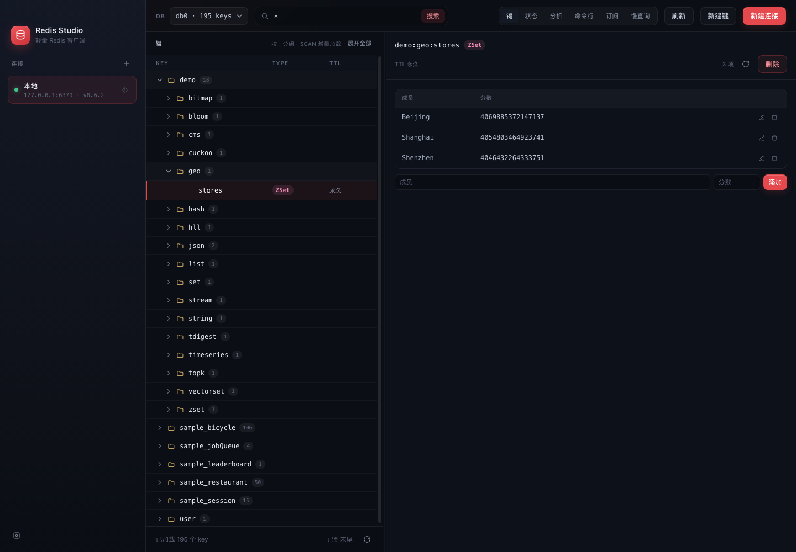
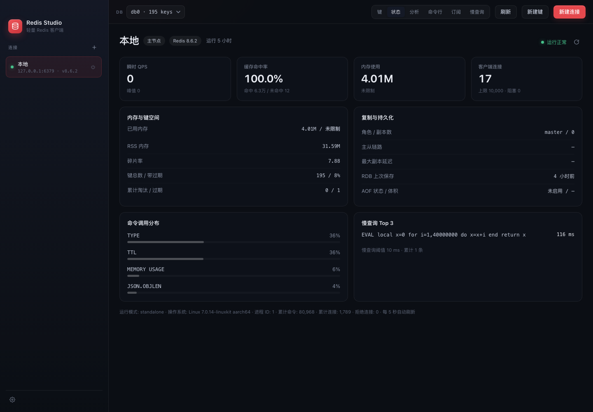
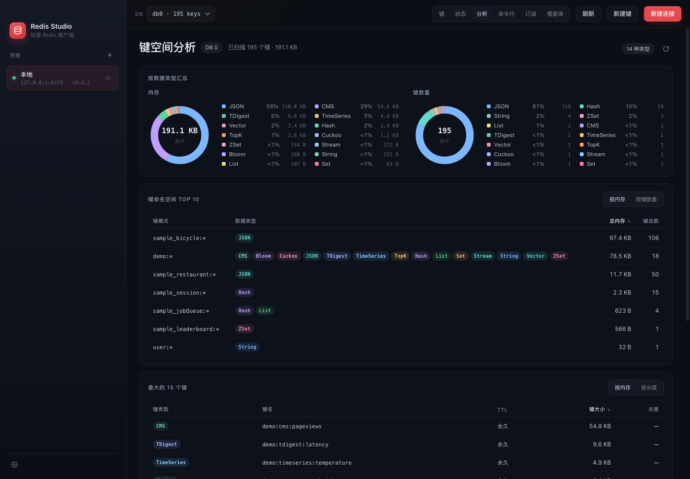
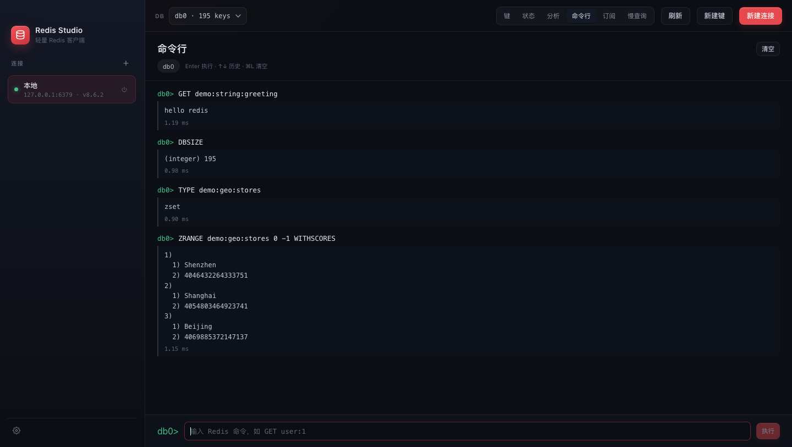

# Redis Studio

轻量的跨平台 Redis 图形客户端，支持 macOS 与 Windows。客户端使用 React + TypeScript，后端使用 Go，通过 Wails v3 打包为原生桌面应用。

## 功能

| 模块 | 能力 |
| --- | --- |
| 连&#8288;接&#8288;管&#8288;理 | Standalone、用户名/密码、TLS、DB 选择；连接按分组整理并可折叠；配置持久化到用户目录，支持离线保存、重连、编辑和带确认的删除 |
| 键&#8288;浏&#8288;览 | SCAN 增量加载、按 `:` 命名空间分组、模式搜索、TTL 展示；键列表宽度根据内容自适应，可拖动分隔条调整 |
| 数&#8288;据&#8288;类&#8288;型 | String、Hash、List、Set、ZSet、Stream、RedisJSON，以及 TimeSeries、Bloom、Cuckoo、CMS、TopK、TDigest、VectorSet 等模块类型 |
| 在&#8288;线&#8288;编&#8288;辑 | String/JSON 编辑、集合类型增删改、模块类型读写；新建键支持 Hash/List/Set/ZSet/Stream 多值初始化 |
| 实&#8288;例&#8288;状&#8288;态 | QPS、命中率、内存、客户端连接、复制与持久化、命令调用分布、慢查询 Top 3 |
| 键&#8288;空&#8288;间&#8288;分&#8288;析 | 按数据类型的内存/键数环形图、Top 10 命名空间、最大的 15 个键，支持按内存、数量、长度排序 |
| 命&#8288;令&#8288;行 | Redis 命令执行、历史记录、命令补全 |
| 发&#8288;布&#8288;订&#8288;阅 | 频道/模式订阅、实时消息流、按订阅过滤、消息发布 |
| 慢&#8288;查&#8288;询 | 独立慢查询页面，展示阈值、数量和时间分布，支持清空 |
| 外&#8288;观&#8288;与&#8288;窗&#8288;口 | 中英文、浅色/深色/跟随系统、小/中/大字号；启动后铺满可用屏幕 |

## 页面预览

### 键浏览与在线编辑



### 实例状态



### 键空间分析



### 命令行



## 技术栈

- [Wails v3](https://v3.wails.io/) + Go 1.26
- [go-redis v9](https://github.com/redis/go-redis)
- React 18 + TypeScript + Vite 8
- 无额外 UI 组件库，图表、布局与交互均为原生实现

## 环境要求

- Go 1.26+
- Wails v3 CLI（`wails3`）
- Node.js 20+ 与 npm
- 本地或远程 Redis；模块类功能需要服务端安装对应模块（开发验证使用 Redis 8.6.2）
- macOS 需要 Xcode Command Line Tools；Windows 需要 WebView2 Runtime

## 快速开始

```bash
git clone git@github.com:whao1996/redis-studio.git
cd redis-studio

# 安装前端依赖（首次运行）
cd frontend && npm install && cd ..

# 启动开发模式（前后端热更新）
wails3 dev
```

如果 `wails3` 不在 PATH 中：

```bash
go install github.com/wailsapp/wails/v3/cmd/wails3@latest
# 或使用 $(go env GOPATH)/bin/wails3
```

## 构建与打包

```bash
# 编译当前平台的可执行文件
wails3 build

# 打包安装产物
wails3 package
```

- macOS：生成 `bin/redis-studio.app`
- Windows：生成 NSIS 安装包，内置 WebView2 引导程序
- 产物统一位于 `bin/` 目录

### Server 模式

无 GUI 的 HTTP 模式适合调试与自动化验证：

```bash
wails3 task build:server
WAILS_SERVER_PORT=34115 ./bin/redis-studio-server
```

启动后访问 `http://127.0.0.1:34115`。

## 测试

```bash
# Go 单元测试（使用 miniredis）
go test .

# 前端类型检查与生产构建
cd frontend && npm run build
```

## 本地演示数据

```bash
# 向 127.0.0.1:6379 写入覆盖各类数据结构的 demo:* 数据
go run ./hack/seed

# 或启动仅供开发使用的 miniredis（127.0.0.1:16379）
go run ./hack/devredis
```

`hack/seed` 支持 `-addr`、`-password`、`-db`、`-prefix` 参数；重复执行会先清理同前缀旧数据。

## 数据与隐私

连接配置（包含密码）只保存在本机：

- macOS：`~/Library/Application Support/redis-studio/connections.json`
- Windows：`%AppData%\redis-studio\connections.json`
- Linux：`~/.config/redis-studio/connections.json`

文件权限为 `0600`，目录权限为 `0700`，写入采用临时文件加原子重命名。连接配置不会上传到任何远程服务。

## 项目结构

```text
.
├── main.go              # Wails 应用入口、窗口初始化与标签栏行为
├── redisservice.go      # 连接、键扫描、值读取与编辑
├── status.go            # 实例状态、慢查询与键空间分析
├── console.go           # 命令行执行与命令列表
├── pubsub.go            # 发布订阅
├── profiles.go          # 连接配置持久化
├── titlebar.go          # 双击标题栏行为适配
├── apperrors.go         # 结构化错误编码
├── frontend/
│   ├── src/
│   │   ├── App.tsx
│   │   ├── components/  # 键浏览器、状态页、分析页、命令行、订阅、慢查询等
│   │   ├── i18n.ts      # 中英文文案
│   │   └── settings.tsx # 语言/主题/字号
│   ├── public/style.css # 全局样式与主题变量
│   └── bindings/        # Wails 生成的前端绑定
├── hack/
│   ├── seed/            # 演示数据写入
│   └── devredis/        # 本地 miniredis
└── build/               # 打包配置、图标与各平台资源
```

## 设计说明

- **键浏览**：SCAN 分页拉取，按 `:` 生成命名空间树；键列表宽度会测量当前可见内容并自动收窄，最大不超过 `720px`。
- **键空间分析**：最多扫描 5000 个键，内存值来自 `MEMORY USAGE`；模块类型没有统一长度命令时显示 `—`。
- **发布订阅**：使用独立连接，关闭或删除应用内连接时一并释放，不依赖服务端持久化。
- **慢查询**：阈值和数量从服务端读取，需要 Redis 已开启 slowlog。
- **当前限制**：仅支持 Standalone，暂不支持 Cluster / Sentinel。
